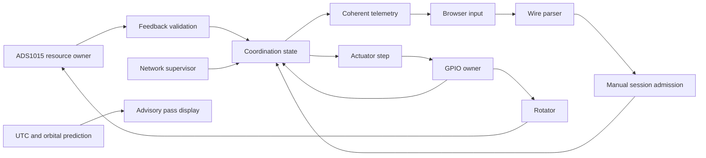

# Architecture

ezal separates deterministic control policy from the RP2350 peripherals that
observe and apply it. Firmware boots idle and moves only in response to fresh
manual input. NTP and orbital forecasts are advisory. Tracking planning and
lifecycle policy exist in the pure core; live tracking integration is pending.

The [manual control contract](CONTROL_CONTRACT.md) defines the safeguard owner,
effect, recovery condition and timing boundaries. It is the reference for
changes to the control path.

## Layers and dependencies

`ezal-core` is `no_std`: policy takes values and explicit monotonic times and
returns values. It has no peripherals, global runtime state or Embassy tasks.

| Boundary | Core owner | Responsibility |
|---|---|---|
| Installation | `position::InstalledCalibration` | Validate immutable geometry and ADC observability once; reuse checked conversion math |
| Observations | `feedback::FeedbackMonitor` | Calibrate timestamped samples, reject bad acquisitions, retain diagnostic readings |
| Source admission | `session::CommandFreshness` | Bound source age and sequence; distinguish a new press from a continued hold |
| Coordination | `coordination::CoordinationState` | Manual ownership, network recovery, atomic observations and command delivery |
| Output decision | `actuator::Actuator` | Apply all final permissions, physical supervision, leases and relay timing in one step |
| Representation | `protocol`, `dashboard` | Decode manual messages, encode telemetry, provide the browser asset and shared timing configuration |

The actuator uses `interlock` for current feedback and endpoint assessments,
`motion` for applied-output progress and plausibility, `duty` for per-axis
energized/rest accounting, and private timing helpers
in `drive`. These helpers do not provide alternative firmware actuation paths.
The per-axis relay state machine is shared by azimuth and elevation. The
`network` gate is a timestamped permission with a recovery generation, not a
cached connection boolean. Private ownership bookkeeping and a mailbox support
coordination; the mailbox stores each command together with its source deadline.

Other core modules remain independent: `ads1015` models registers and decoding;
`wifi` validates credentials and selects retry delays; `ntp` validates packets
and maintains an expiring UTC anchor; `http`, `orbit` and `passes` parse streamed
elements and calculate reception windows. UTC never drives motion timers.

The offline tracking policy has separate ownership for operator authority and
the selected run. `operator::OperatorLease` enforces exclusive, expiring grants;
`tracking::TrackingSession` binds the selection, planning tickets, frozen inputs,
executor generations and pending output. Releasing a browser grant does not
release an armed run. The planner and lifecycle both use the existing actuator
policy, so simulation, preparation and later following share duty and relay
constraints. See the [lifecycle milestone](PASS_PREDICTION.md#current-lifecycle-milestone)
for the transition and integration contract. The current firmware's manual
coordination remains the only live output source until that integration.

`ezal-firmware` owns the asynchronous shell:

| Module | Resources and effects |
|---|---|
| `main` | Peripheral wiring, startup checks and task spawning |
| `feedback` | ADC reader, cancellation latch and acquisition cadence |
| `ads1015` | I²C transactions and ADC power-on test |
| `state` | Short critical sections around core coordination; a wake signal |
| `drive` | Four direction GPIOs, actuator scheduling and watchdog feeding |
| `watchdog` | Hardware reset configuration and reset-cause detection |
| `wifi` | Radio initialization, one retry owner, association, DHCP and link observations |
| `web`, `ws_receive` | HTTP/WebSocket I/O, bounded message assembly and receive deadlines |
| `time`, `prediction` | NTP I/O, streamed TLE downloads and cooperative forecast work |

## Feedback lifecycle

The resource-owning reader timestamps before A0 elevation, then reads A1 azimuth
under one 500 ms transaction deadline. Cancelling that transaction permanently
disables reads on that owned bus until reset. An uncancelled I²C error may retry.
The monitor does not own or reset hardware-resource state.

`InstalledCalibration` checks that the full accepted calibration band is
observable at the ADC's configured range and supply ceiling. Every raw pair
still receives rail and range checks. `FeedbackSample` can only be constructed
through calibrated conversion and retains the original acquisition timestamp.
A completed read taking more than 150 ms, or a future timestamp, cannot publish
a usable sample. There is a 100 ms delay after each acquisition, rather than a
fixed-frequency sampling promise.

One publication contains the domain feedback snapshot and the interlock built
from the same installation. Raw readings and the last valid position remain
available for diagnostics after faults. They do not grant permission to move:
the interlock receives no usable sample on a fault. Invalid installation settings
keep sampling active so endpoints can be measured again. The wire adapter maps
health to dashboard fields; the domain does not construct protocol messages.

The actuator independently evaluates sample age and travel margins at use. Age
is measured from the original oldest-channel timestamp, including bus delay.
The endpoint margin combines ADC resolution and the fastest possible travel
since that timestamp plus configured release/coast; it can cut an outward axis
without stopping an unaffected axis. See [CALIBRATION.md](CALIBRATION.md) for
conversion limits and installation.

## Coordination and the output loop

`SharedState` wraps `CoordinationState` with a critical-section mutex. No lock
crosses an await or performs I/O. Transitions receive the current time explicitly;
snapshot getters do not expire permission, revoke ownership or consume commands.
Admission and actuator polling apply time-dependent transitions.

The first connected client receives unclaimed control while networking is ready.
Takeover and owner disconnect queue immediate inhibition. An old owner's commands
or later disconnect cannot affect a replacement owner. A viewer is not silently
promoted when the owner leaves. Network loss revokes ownership and queued motion;
recovery requires ownership and new operator input.

The signal is only a wake hint. On every iteration, the GPIO task atomically
drains the mailbox together with the feedback interlock and network permission.
Notifications can coalesce without losing an unconsumed inhibition. Replacing
a pending movement replaces its entire envelope, including the original expiry.

`Actuator::step(input, now)` is the production output boundary:

1. Account for motion and duty under the previously applied output, before any cut.
2. Assess feedback, duty and latched motion faults; revoke active and pending requests
   when permission is absent or the network recovery generation changed.
3. Consume a queued command before advancing a pending relay activation at the
   same instant. Expire an old lease before admitting a late refresh.
4. Record the resulting applied state and return output, fault/duty status and the
   earliest required service deadline.

Command lifetime and remaining duty must both cover an activation's minimum on-time.
Feedback and network deadlines independently revoke movement; shortening the
activation lease to the 300 ms network deadline would prevent every activation.
The private relay timing model retains ordinary `Drive`/`Stop` semantics; manual
admission produces only operator-held `Jog` or immediate `Inhibit` requests.

Firmware applies the returned GPIO state, records it, and only then feeds the
500 ms watchdog. It waits for a wake hint or the earlier of the returned deadline
and its fixed 100 ms service schedule. Acquisition and GPIO servicing remain
separate tasks, so a stuck sensor read cannot suspend output supervision.

Motion supervision retains accumulated energized time across short jogs, reversals
and off-holds, and keeps direction/speed evidence across pulse trains. There is no
per-activation blind window. Fresh communication or sensor recovery cannot erase
a latched fault. `ActuatorConfig` supplies one validated set of relay, travel,
motion and duty settings. Duty is per axis and survives source/owner changes;
only full continuous rest restores it. Firmware boot uses unknown history and
requires a full rest. Simulations explicitly provide their known prior usage.
The detailed timing and recovery rules live in [CONTROL_CONTRACT.md](CONTROL_CONTRACT.md).

## Transport and dashboard

Each periodic WebSocket message carries one coherent snapshot: raw position,
calibrated feedback health, ownership, applied output, per-axis duty and a
freshness proof.
The proof is stamped before the state read and socket write, so a slow write
consumes its one-second lifetime. Encoding uses a fixed 640-byte buffer; an
encoding failure closes the session and releases ownership explicitly.
Control acknowledgements carry no proof and never renew telemetry lifetime.

Movement uses `press:<token>:<sequence>:drive:cw` for new input and `hold:…` for
refreshes; combined axes use `cw+up`. Bare movement messages are rejected.
Tokens are decimal strings to preserve all `u64` values in JavaScript. Admission
binds proofs to the connection and network generation, checks increasing input
sequence, and bounds expiry by the earlier of token expiry and receipt plus
750 ms. Invalid movement abandons held intent and invalidates issued tokens.
Stops need no freshness proof but still require ownership.

The browser uses explicit control-state transitions that return requested effects.
One adapter performs socket sends, pointer capture, timers and DOM rendering.
Each axis holds one pointer claim; desired movement is distinct from server-applied
output. Telemetry loss, control loss and page suspension clear held intent.
Duty exhaustion clears and disables only the affected axis's hold and shows
its rest countdown; allowance recovery requires a new press.
Recovery requires a fresh physical press. `/dashboard-config.js` is generated
from the firmware's timing constants, and the Node tests execute that exact
configuration with the served script. Forecast fetching and presentation remain
independent of command freshness.

Receive outcomes distinguish a complete message, telemetry tick, I/O error,
protocol error and timeout. The 2 s whole-message deadline covers fragmented
messages and interleaved control replies. Cancellation ends the connection;
it never resumes a partially consumed parser. The bounded assembler uses the
pinned picoserve frame decoder because its message assembler rejects legal
interleaved control frames. Closing or dropping a session releases ownership
before a potentially slow close response.

Eight independent acceptors serve the dashboard, WebSockets and `/api/passes`.
Each acceptor owns a copied forecast report and streams its JSON directly into
the transmit buffer, avoiding large copies in nested futures or locks across
slow clients. Eight persistent WebSockets consume all acceptors. Manual ownership
prevents conflicting clients on the trusted local network; it is not authentication.

## Startup and recovery

Direction pins are claimed low before other startup work. A firmware-watchdog
reset parks startup with those outputs and the stopped watchdog held. Otherwise,
the output task starts before the ADC POST. A failed or cancelled POST parks
startup with the ADC retained, while the output task continues servicing idle
outputs. Immutable invalid WiFi credentials park the radio owner after one log;
feedback and output tasks remain alive and network permission stays absent.

The WiFi supervisor owns all retries. A join follows bounded leave/settle cleanup;
the initial join gets 2.75 s, with two prompt timeout retries at 3.5 s. Other
failures and exhausted prompt retries use 1, 2, 4, …, 30 s backoff. DHCP has a
30 s deadline. Only a usable link and address reset the retry schedule. Readiness
is local connectivity, not internet reachability. A 100 ms observation cadence
renews permission that independently expires after 300 ms at the actuator.

HTTP acceptors are spawned once and survive networking outages. Radio firmware
initialization precedes supervision; failures involving consumed hardware
resources require reset. Automatic networking or feedback recovery never clears
an ADC cancellation latch or physical motion fault.

## Verification

Host tests exercise the production coordination-to-actuator path, source expiry,
coalesced commands, permission loss/recovery, pending relay transitions, endpoint
cuts, motion faults, conversion limits and bounded WebSocket reception. Internal
relay tests retain focused timing coverage. Dashboard tests execute the served
JavaScript and Rust-generated configuration with controlled clocks, sockets and
pointer events. Forecast tests share the firmware's serialized report fixture.

CI checks formatting, host tests, browser behavior, Clippy and the release
firmware/UF2 build. [DEVELOPMENT.md](DEVELOPMENT.md) contains commands and board
acceptance checks. Host tests do not measure physical stopping time: relay release,
mechanical coast and pad behavior during watchdog reset still require bench
validation with the installed [hardware](HARDWARE.md).
