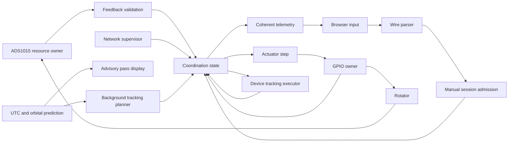

# Architecture

ezal separates deterministic control policy from the RP2350 peripherals that
observe and apply it. Firmware boots idle. Manual movement and explicitly armed
tracking use one device owner and physical output boundary. Host tests validate
the policy; board timing and the installation are validated by the
[bench verification](CALIBRATION.md#bench-verification).

The [control contract](CONTROL_CONTRACT.md) defines the safeguard owner,
effect, recovery condition and timing boundaries. It is the reference for
changes to the control path.

## Layers and dependencies

`ezal-core` is `no_std`: policy takes values and explicit monotonic times and
returns values. It has no peripherals, global runtime state or Embassy tasks.

| Boundary | Core owner | Responsibility |
|---|---|---|
| Installation | `position::InstalledCalibration` | Validate immutable geometry and ADC observability once; reuse checked conversion math |
| Observations | `feedback::FeedbackMonitor` | Calibrate timestamped samples, reject bad acquisitions, retain diagnostic readings |
| Source admission | `session::CommandFreshness` | Bound source age and sequence; distinguish a new press from a continued hold |
| Coordination | `coordination::CoordinationState` | Exclusive operator lease, tracking runtime, input revisions and coherent command delivery |
| Output decision | `actuator::Actuator` | Apply all final permissions, physical supervision, leases and relay timing in one step |
| Representation | `protocol`, `dashboard` | Decode manual/tracking intent, encode telemetry, provide the browser asset and shared timing configuration |

The actuator uses `interlock` for current feedback and endpoint assessments,
`motion` for applied-output progress and plausibility, `duty` for per-axis
energized/rest accounting, and private timing helpers
in `drive`. These helpers do not provide alternative firmware actuation paths.
The per-axis relay state machine is shared by azimuth and elevation. The
`network` gate is a timestamped permission with a recovery generation, not a
cached connection boolean. `TrackingLifecycle`'s private mailbox stores each
command together with its source deadline.

Other core modules remain independent: `ads1015` models registers and decoding;
`wifi` validates credentials and selects retry delays; `ntp` validates packets
and maintains an expiring UTC anchor; `http` and `orbit` parse streamed elements,
`catalog` publishes them and `passes` calculates reception windows. UTC never
drives motion timers.

Tracking has separate ownership for operator authority and
the selected run. `operator::OperatorLease` enforces exclusive, expiring grants;
`tracking::TrackingLifecycle` binds the selection, planning tickets, frozen inputs,
executor generations and pending output. Releasing a browser grant does not
release an armed run. The planner and lifecycle both use the existing actuator
policy, so simulation, preparation and later following share duty and relay
constraints. See [TRACKING.md](TRACKING.md#lifecycle-events) for the transition
contract. `CoordinationState` owns one `TrackingRuntime`;
manual admission uses that runtime's exclusive lease and mailbox too.

`tracking::TrackingRuntime` wraps that lifecycle with the execution-input gate.
The firmware uses this owner: it validates source snapshots,
clock corrections and timestamped network generations before preparation,
executor commands and mailbox drain. `ExecutionInputs` owns its elements,
observer and millisecond UTC anchor; later publications cannot edit a frozen
run. Only a completed `OrbitalDownload` can publish element sets and their
revisions to `catalog::Catalog`. The installation explicitly accepts
HTTP orbital data; these types establish framing/validation and identity, not
cryptographic authenticity. NTP also remains unauthenticated.

The same runtime owns deviation monitoring and recovery. One episode retains
its original deadline across settling and intercept retries. Incremental search
borrows the frozen route/source and simulates the remaining pass from a copy of
the serviced actuator, preserving duty and relay history. Recovery commands
come only from the validated intercept and existing feedback follower; ordinary
following commands are refused during recovery. Late work, stale feedback,
faults and cancellation cannot revive an old intercept. See
[TRACKING.md](TRACKING.md#firmware-execution) for the output cadence and
integration contract.

`ezal-firmware` owns the asynchronous shell:

| Firmware module | Owned resources and effects |
|---|---|
| `main` | Peripheral wiring, startup checks and task spawning |
| `feedback` | ADC reader, cancellation latch and acquisition cadence |
| `ads1015` | I²C transactions and ADC power-on test |
| `state` | Core-0 thread-mode borrows around coordination; a wake signal |
| `drive` | Four direction GPIOs, tracking execution, actuator scheduling and watchdog feeding |
| `tracking` | Yielding preview/recovery planning and execution timing diagnostics |
| `watchdog` | Hardware reset configuration and reset-cause detection |
| `wifi` | Radio initialization, one retry owner, association, DHCP and link observations |
| `web`, `ws_receive` | HTTP/WebSocket I/O, bounded message assembly and receive deadlines |
| `time`, `prediction` | NTP I/O, streamed TLE downloads and cooperative forecast work |

## Feedback lifecycle

The resource-owning reader timestamps before A0 elevation, then reads A1 azimuth
under one transaction deadline,
[`FEEDBACK_READ_TIMEOUT_MS`](CONTROL_CONTRACT.md#ownership-and-recovery).
Cancelling that transaction permanently disables reads on that owned bus until
reset. An uncancelled I²C error may retry. The monitor does not own or reset
hardware-resource state.

`InstalledCalibration` checks that the full accepted calibration band is
observable at the ADC's configured range and supply ceiling. Every raw pair
still receives rail and range checks. `FeedbackSample` can only be constructed
through calibrated conversion and retains the original acquisition timestamp.
A completed read slower than
[`FEEDBACK_MAX_LATENCY_MS`](CONTROL_CONTRACT.md#ownership-and-recovery), or a
future timestamp, cannot publish a usable sample.
[`FEEDBACK_PERIOD_MS`](../crates/ezal-core/src/feedback.rs) separates
acquisitions; there is no fixed-frequency sampling promise.

One publication contains the domain feedback snapshot and the interlock built
from the same installation. Raw readings and the last valid position remain
available for diagnostics after faults. They do not grant permission to move:
the interlock receives no usable sample on a fault. Invalid installation settings
keep sampling active so endpoints can be measured again. The wire adapter maps
health to dashboard fields; the domain does not construct protocol messages.

The actuator independently evaluates sample age and travel margins at use. Age
is measured from the original oldest-channel timestamp, including bus delay.
The endpoint margin combines ADC resolution and the fastest possible travel
since that timestamp plus configured release/coast; it can cut an outward axis
without stopping an unaffected axis. See [CALIBRATION.md](CALIBRATION.md) for
conversion limits and installation.

## Coordination and the output loop

`SharedState` wraps `CoordinationState` with `ThreadModeRawMutex`. All users
run on the core-0 thread executor; core 1 and interrupt executors must not access
this state. IRQs stay enabled during bounded propagation/planning. No borrow
crosses an await or performs I/O. Transitions receive the current time explicitly;
snapshot getters do not expire permission, revoke ownership or consume commands.
Admission and actuator polling apply time-dependent transitions.

The first connected client receives unclaimed control while networking is ready.
A viewer cannot displace its exclusive lease,
[`OPERATOR_LEASE_MS`](CONTROL_CONTRACT.md#ownership-and-recovery). Fresh
single-use WebSocket Ping/Pong heartbeats renew the original grant; reading
telemetry and repeated claims do not. Disconnect or expiry inhibits manual
movement while an armed pass retains device authority. A viewer must claim
vacant control explicitly. Network loss revokes browser ownership and stops
tracking; recovery cannot resume an old run.

The signal is only a wake hint. On every iteration, the GPIO task atomically
drains the mailbox together with the feedback interlock and network permission.
Notifications can coalesce without losing an unconsumed inhibition. Replacing
a pending movement replaces its entire envelope, including the original expiry.

`Actuator::step(input, now)` is the production output boundary:

1. Account for motion and duty under the previously applied output, before any cut.
2. Assess feedback, duty and latched motion faults; revoke active and pending requests
   when permission is absent or the network recovery generation changed.
3. Consume a queued command before advancing a pending relay activation at the
   same instant. Expire an old lease before admitting a late refresh.
4. Record the resulting applied state and return output, fault/duty status and the
   earliest required service deadline.

Command lifetime and remaining duty must both cover an activation's minimum on-time.
Feedback and network deadlines independently revoke movement; shortening the
activation lease to the network deadline,
[`NETWORK_HEALTH_TIMEOUT_MS`](CONTROL_CONTRACT.md#ownership-and-recovery),
would prevent every activation.
Tracking `Drive` releases an axis it no longer requests after its minimum on-time;
manual admission produces only operator-held `Jog` or immediate `Inhibit` requests.

Firmware applies and records the first service result before generating a
tracking command from that coherent actuator snapshot. It then drains with the
actual current time and applies/records the second result. Every intermediate
transition reaches GPIOs and both follower histories. Only then does it feed the
watchdog. The [contract](CONTROL_CONTRACT.md#ordering-and-time) sets the idle
and tracking service periods; physical, preparation, intercept and LOS deadlines
shorten them. The runtime inhibits at the next service if normal execution
exceeds the plan's maximum interval,
[`PlanningConfig::step_ms`](CONTROL_CONTRACT.md#ownership-and-recovery);
recovery instead discards late work and holds/retries within its episode.
Acquisition and GPIO servicing remain separate tasks, so a stuck sensor read
cannot suspend output supervision.

Motion supervision retains accumulated energized time across short jogs, reversals
and off-holds, and keeps direction/speed evidence across pulse trains. Direction
checks apply from a pulse's first sample through its coast; once an axis has
been driven, its speed stays bounded through startup, coast and idle. Fresh
communication or sensor recovery cannot erase a latched fault. `ActuatorConfig`
supplies one validated set of relay, travel, motion and duty settings. Duty is per
axis and survives source/owner changes; only full continuous rest restores it.
Firmware boot uses unknown history and requires a full rest. Simulations
explicitly provide their known prior usage. The detailed timing and recovery
rules live in [CONTROL_CONTRACT.md](CONTROL_CONTRACT.md).

## Transport and dashboard

Each periodic WebSocket message carries one coherent snapshot: raw position,
calibrated feedback health, ownership, applied output, per-axis duty, a small
tracking projection and a freshness proof. Tracking includes the selected event,
revision, lease generation, preview, phase, matched deviation, recovery and final
summary. It copies no route or orbital source and never propagates while reading.
The proof is stamped before the state read and socket write, so a slow write
consumes its lifetime,
[`COMMAND_MAX_AGE_MS`](CONTROL_CONTRACT.md#ownership-and-recovery). Encoding
uses a fixed 4096-byte buffer; an encoding failure closes the session and
releases ownership explicitly. Control acknowledgements carry no proof and never
renew telemetry lifetime.

Movement uses `press:<token>:<sequence>:drive:cw` for new input and `hold:…` for
refreshes; combined axes use `cw+up`. Bare movement messages are rejected.
Tokens are decimal strings to preserve all `u64` values in JavaScript. Admission
binds proofs to the connection and network generation, checks increasing input
sequence, and bounds expiry by the earlier of token expiry and receipt plus
[`MOVEMENT_LEASE_MS`](CONTROL_CONTRACT.md#ownership-and-recovery). Invalid
movement abandons held intent and invalidates issued tokens. Manual stops need
no freshness proof but still require ownership and Manual mode. Tracking actions
carry a separate intent sequence, the observed lease generation and state
revision. Select/Arm/Prepare also require the recent telemetry proof;
Cancel/Manual can use stale observations while retaining current-lease and
ordering checks. New selections must match a currently offered device forecast
row, identified by NORAD and AOS/LOS, never a browser table index.

The browser uses explicit control-state transitions that return requested effects.
One adapter performs socket sends, pointer capture, timers and DOM rendering.
Each axis holds one pointer claim; desired movement is distinct from server-applied
output. Telemetry loss, control loss and page suspension clear held intent.
Duty exhaustion clears and disables only the affected axis's hold and shows
its rest countdown; allowance recovery requires a new press.
Recovery requires a fresh physical press. `/dashboard-config.js` is generated
from the firmware's timing constants, and the Node tests execute that exact
configuration with the served script. Forecast fetching and presentation remain
independent of command freshness. The UI hides manual controls in Tracking,
waits for device acknowledgement/state, and never replays intent on reconnect.
A stale measured sample is shown as unavailable, with final metrics kept separate.

Receive outcomes distinguish a complete message, telemetry tick, I/O error,
protocol error and timeout. The 256-byte receive bound accommodates tracking
intent with full-width identifiers and legal control frames. The 2 s whole-message deadline covers fragmented
messages and interleaved control replies. Cancellation ends the connection;
it never resumes a partially consumed parser. The bounded assembler uses the
pinned picoserve frame decoder because its message assembler rejects legal
interleaved control frames. Closing or dropping a session releases ownership
before a potentially slow close response.

Eight independent acceptors serve the dashboard, WebSockets and `/api/passes`.
Each acceptor owns a copied forecast report and streams its JSON directly into
the transmit buffer, avoiding large copies in nested futures or locks across
slow clients. Eight persistent WebSockets consume all acceptors. Manual ownership
prevents conflicting clients on the trusted local network; it is not authentication.

## Startup and recovery

Direction pins are claimed low before other startup work. A firmware-watchdog
reset parks startup with those outputs and the stopped watchdog held. Otherwise,
the output task starts before the ADC POST. A failed or cancelled POST parks
startup with the ADC retained, while the output task continues servicing idle
outputs. Immutable invalid WiFi credentials park the radio owner after one log;
feedback and output tasks remain alive and network permission stays absent.

The WiFi supervisor owns all retries. A join follows bounded leave/settle cleanup;
the initial join gets 2.75 s, with two prompt timeout retries at 3.5 s. Other
failures and exhausted prompt retries use 1, 2, 4, …, 30 s backoff. DHCP has a
30 s deadline. Only a usable link and address reset the retry schedule. Readiness
is local connectivity, not internet reachability. Each observation renews a
permission that the actuator expires independently; the
[contract](CONTROL_CONTRACT.md#ownership-and-recovery) gives both periods.

HTTP acceptors are spawned once and survive networking outages. Radio firmware
initialization precedes supervision; failures involving consumed hardware
resources require reset. Automatic networking or feedback recovery never clears
an ADC cancellation latch or physical motion fault.

## Verification

Integration tests in `crates/ezal-core/tests/` exercise the public API, one
binary per file. The exception is `ws_receive.rs`, which compiles the firmware's
private receive adapter through `#[path]` so it runs against the pinned
picoserve parser. A binary that needs child modules is a directory,
`tests/<bin>/main.rs`, and those modules belong to that binary alone.
`tests/common/` holds fixtures that two or more binaries share; the in-crate
tests reach the same fixtures through the documented splice in `lib.rs`. A unit
test lives in the crate, in `src/<module>/tests.rs` or a `tests` module at the
foot of a small file, only when its subject is crate-private. The JSON fixtures
pin the wire formats that the dashboard tests render, so a server change cannot
silently break the client.

CI runs the scripts in [DEVELOPMENT.md](DEVELOPMENT.md). Host tests do not
measure physical stopping time: relay release, mechanical coast and pad
behaviour during watchdog reset need the
[bench verification](CALIBRATION.md#bench-verification) on the installed
[hardware](HARDWARE.md).

## Conventions

A comment states what the code does or why a value is what it is. It never
names a milestone, a removed mechanism, a word that dates the text, such as
"now" or "currently" describing the project, or a future component; status
words such as "provisional" state a fact and stay. A value that a constant owns
is linked, not restated. A module doc states what the module owns and where its
boundary is, links the datasheet or specification instead of teaching the
technology, and never addresses the reader.
